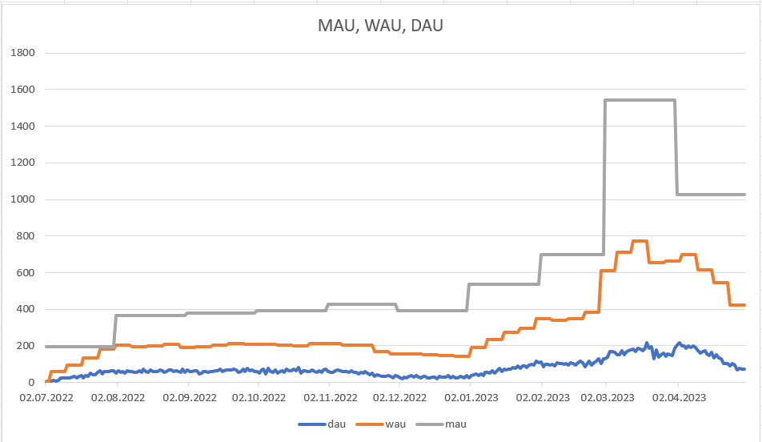
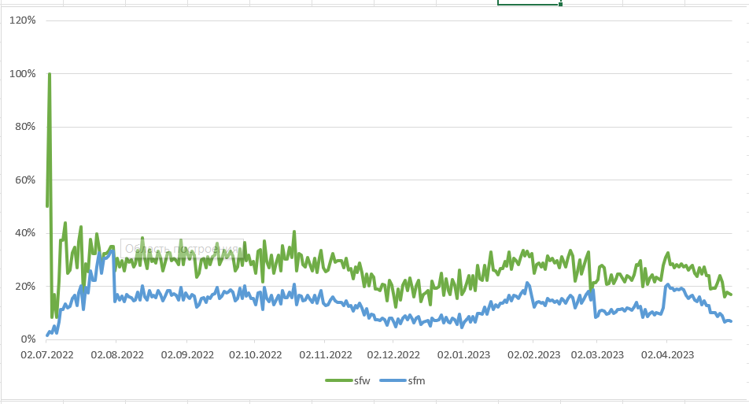

# Game metrics, player engagement and data quality (SQL)

Training case project based on a mobile game dataset.

## Tasks
1. Marketing promotion: calculate DAU, WAU and MAU and sticky factors
   to check whether a promotion rewarding frequent players had a positive effect.
2. Most engaged players: find the top 25 players by total time in the game
   among players registered in 2022 (join of users and game sessions).
3. Data quality: measure the share of sessions with a missing end time,
   overall and by device type (iOS / Android).

## Tools
SQL (PostgreSQL), spreadsheets (Excel / Google Sheets)

## Charts
DAU, WAU, MAU:

Sticky factor (weekly and monthly):

## Files
- queries.sql: all SQL queries for the tasks above
- dau-wau-mau-sticky-factor.xlsx: table with metrics and charts
