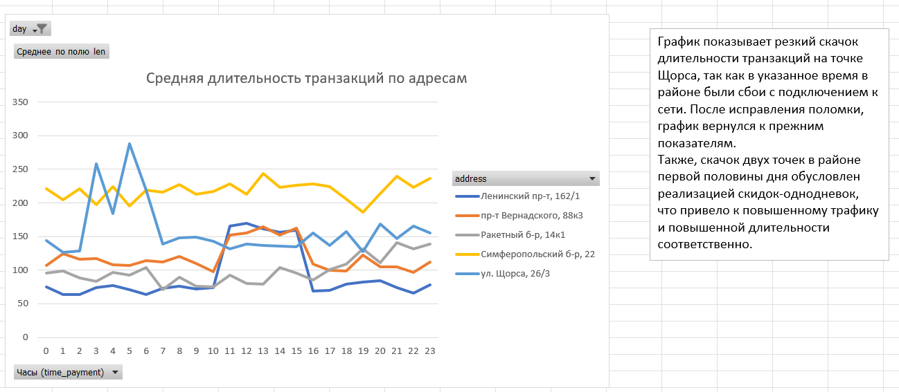
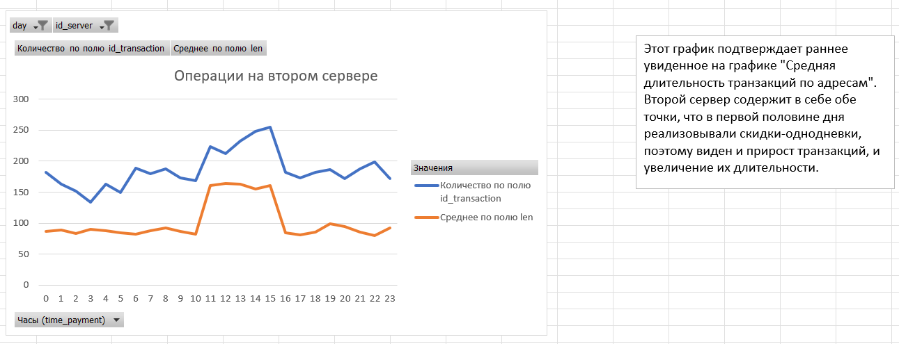
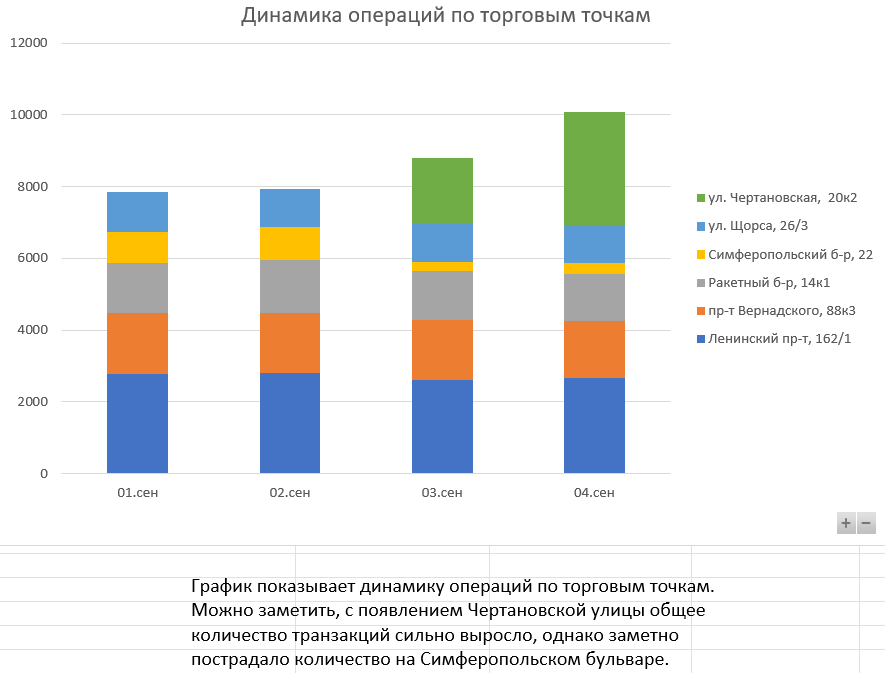

# Retail operations: investigating a spike in transaction duration (Excel)

Training case project based on a grocery retailer dataset
(about 35,000 transactions, 6 stores, 3 servers, 1-4 September 2022).

## Task
Find out why the average duration of transactions spiked on 1 September
using segmentation by store, server and hour.

## Tools
Excel: pivot tables, pivot charts, text annotations

## Key findings
1. Shchorsa St. store (server 1): between about 3:00 and 7:00 average
   duration rose to 220-290 s without growth in transactions, which points
   to a connectivity failure.
2. Leninsky Ave. and Vernadsky Ave. stores (server 2): between 11:00 and
   16:00 duration rose to about 160 s (from about 85 s) while hourly
   transactions grew by 30-45%, consistent with a one-day promotion.
3. Additional analysis: after a new store (Chertanovskaya St.) appeared on
   3 September, total transactions grew, while the Simferopolsky Blvd store
   dropped from about 900 to about 230-290 transactions per day.

## Charts

